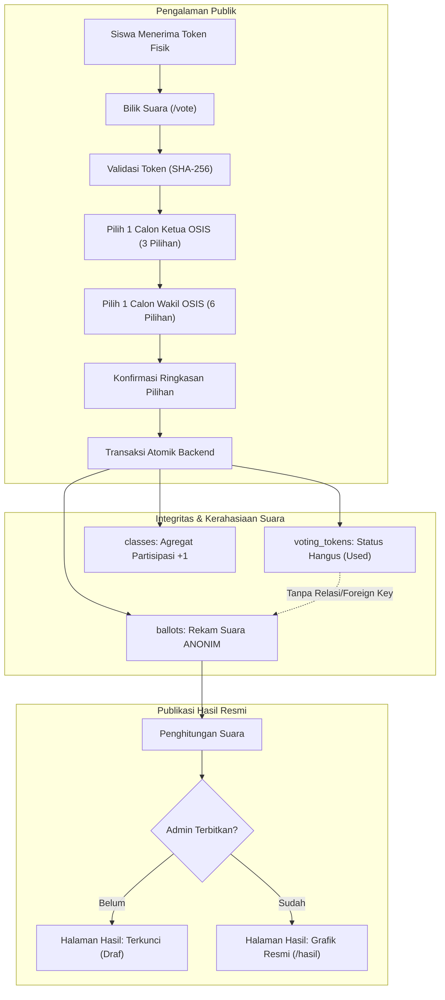

# E-PILKETOS SMKN 4 KOTA SERANG
### Platform Pemilihan Digital OSIS Interaktif 3D & Berstandar Keamanan Kelas Dunia

> **E-PILKETOS SMKN 4 KOTA SERANG** adalah sistem pemilihan umum digital Ketua dan Wakil Ketua OSIS dengan visual interaktif futuristik, minimalis, dan elegan terinspirasi Apple design dan creative studio kontemporer. Dibangun secara *end-to-end* dengan Next.js App Router, TypeScript, Three.js, Tailwind CSS, dan Supabase PostgreSQL.
>
> 🌐 **Live Production**: [https://epilketos-smkn4.vercel.app](https://epilketos-smkn4.vercel.app)  
> 🗄️ **Supabase Instance**: `cixheujqanrhkoijjjyo` (Region: `ap-southeast-1`)  
> 🚀 **Vercel Project**: `epilketos-smkn4` (Production Deployed)

---

## 1. Arsitektur Sistem & Alur Demokrasi Rahasia



---

## 2. Tech Stack & Dependensi

- **Frontend & Framework**: Next.js 16 (App Router), React 19, TypeScript
- **Styling & Design Tokens**: Tailwind CSS v4 dengan palet:
  - Pearl White (`#F8FAFC`)
  - Pure White (`#FFFFFF`)
  - Silver (`#CBD5E1`)
  - Cool Gray (`#64748B`)
  - Deep Graphite (`#111827`)
  - Electric Blue (`#3B82F6`)
  - Soft Cyan (`#67E8F9`)
- **3D Interactive Experience**: Three.js WebGL (Metallic Gyroscopic Orb dengan pointer parallax & scroll reactivity + WebGL fallback)
- **Animasi & Efek**: Framer Motion, Canvas Confetti
- **Ikonografi & Komponen**: Lucide React
- **Basis Data & Autentikasi**: Supabase PostgreSQL dengan Row Level Security (RLS) & Atomic RPC `cast_vote`
- **Spreadsheet & Cetak**: SheetJS (`xlsx`) untuk ekspor token ke Excel dan format lembar potong kartu (`/admin/tokens/print`)
- **Mode Hybrid**: Berjalan instan dengan *Built-in Storage Engine* tanpa dependensi eksternal, dan langsung terhubung ke Supabase saat kredensial `.env.local` disetel.

---

## 3. Fitur Utama

### A. Pengalaman Publik (Siswa & Pengunjung)
1. **Cinematic Intro**: Animasi pembuka 1–2 detik dengan simbol E-PILKETOS, dapat dilewati (*skippable*), dan otomatis disimpan di `sessionStorage` agar tidak berulang.
2. **Hero 3D Interaktif**: Tipografi editorial besar:
   > *"SUARA KITA. MASA DEPAN KITA."*
   Fokus visual orb logam/kaca dengan cincin giroskopik perak, partikel, pencahayaan electric blue, dan fallback poster elegan untuk perangkat tanpa WebGL.
3. **Eksplorasi Kandidat Independen**:
   - **3 Calon Ketua OSIS**: Profil lengkap, visi, misi, dan program prioritas.
   - **6 Calon Wakil Ketua OSIS**: Bebas dikombinasikan pemilih (bukan pasangan paket tetap).
4. **Bilik Suara Digital Terproteksi**:
   - Masukkan token acak sekali pakai.
   - Pilih tepat 1 Ketua dan 1 Wakil.
   - Periksa ringkasan pilihan dan konfirmasi.
   - Server memproses dalam transaksi atomik.
   - Layar sukses *"SUARAMU TELAH TERCATAT"* tanpa membocorkan pilihan pada bukti.
5. **Halaman Hasil Resmi**:
   - Sebelum diterbitkan: Menampilkan pesan resmi bahwa hasil belum dibuka ke publik.
   - Setelah diterbitkan admin: Grafik perolehan suara live, persentase resmi, dan total pemilih sah terverifikasi.

### B. Portal Administrasi Panitia (`/admin`)
Hanya 2 akun terotorisasi:
1. **Ketua Panitia**: `ketua.panitia` (Kata sandi default: `SerangUnggul2026!`)
2. **Admin Utama**: `admin.utama` (Kata sandi default: `PilketoSMKN4_Secure!`)

Fitur Panel:
- **Ikhtisar Dashboard**: Metrik token diterbitkan, dipakai, sisa, dibatalkan, total surat suara, dan turnout per kelas.
- **Manajemen Kandidat**: Tambah, ubah foto, visi, misi, program kerja, dan urutan nomor urut kandidat.
- **Manajemen Kelas & Kuota**: 30 rombel SMKN 4 Kota Serang (8 jurusan: TKJ, TSM, TKRO, TBSM, MPLB, AK, TEI, TITL @ 36 siswa/rombel = 1.080 pemilih) dengan fitur impor spreadsheet (.xlsx/.csv).
- **Generator Token Kriptografis**: Membuat token batch per alokasi kelas (format `PLK-XXXX-YYYY`), pembatalan (*revoke*) dengan alasan resmi, penerbitan token pengganti, ekspor Excel, dan cetak lembar gunting kartu.
- **Kontrol Pemilihan & Publikasi**: Buka/tutup voting secara manual, publikasi/tarik hasil dengan dialog konfirmasi aman.
- **Audit Trail Keamanan**: Log seluruh aktivitas administratif tanpa mencatat pilihan pemilih.

---

## 4. Prinsip Kerahasiaan Suara (Secret Ballot)

1. **Pemisahan Entitas**: Tabel `voting_tokens` (berisi status token dan id kelas) dipisahkan secara total dari tabel `ballots` (berisi pilihan calon ketua dan wakil).
2. **Tidak Ada Foreign Key**: Tabel `ballots` **sama sekali tidak memiliki foreign key** ke `token_id`, nama siswa, NISN, atau alamat IP.
3. **Penyimpanan Hashed**: Token disimpan di database dalam bentuk hash SHA-256 sehingga token mentah tidak dapat direkonstruksi.
4. **Anti-Double Voting**: Baris token langsung dikunci (*Row Lock*) dan status diubah menjadi `used` saat voting dikonfirmasi.

---

## 5. Cara Menjalankan Secara Lokal

### Prasyarat
- Node.js versi 18 atau lebih baru
- npm / pnpm

### Langkah Instalasi
```bash
# 1. Clone repository
git clone <url-repo>
cd optimistic-euclid

# 2. Instal dependensi
npm install

# 3. Jalankan server pengembangan
npm run dev
```

Buka peramban di:
- **Halaman Publik**: [http://localhost:3000](http://localhost:3000)
- **Bilik Suara**: [http://localhost:3000/vote](http://localhost:3000/vote)
- **Portal Admin**: [http://localhost:3000/admin/login](http://localhost:3000/admin/login)

### Menjalankan Pengujian Otomatis
```bash
npm test
```
Seluruh 43 pengujian integritas (kriptografi token, atomisitas suara, pencegahan voting ganda, kerahasiaan suara, audit keamanan HMAC, rate limiting, dan kontrol status) akan dijalankan secara otomatis.

---

## 6. Konfigurasi Supabase (PostgreSQL)

Jika ingin menghubungkan langsung ke instance Supabase:

1. Buat proyek baru di [database.new](https://database.new).
2. Salin isi file `supabase/migrations/20260101_init_schema.sql` ke dalam **SQL Editor** Supabase dan klik **Run**.
3. Salin isi file `supabase/seed.sql` ke dalam **SQL Editor** untuk mengisi data awal kandidat dan kelas SMKN 4 Kota Serang.
4. Salin file `.env.example` menjadi `.env.local`:
   ```bash
   cp .env.example .env.local
   ```
5. Isi variabel kredensial Supabase di `.env.local`:
   ```env
   NEXT_PUBLIC_SUPABASE_URL=https://<project-id>.supabase.co
   NEXT_PUBLIC_SUPABASE_ANON_KEY=<your-anon-key>
   SUPABASE_SERVICE_ROLE_KEY=<your-service-role-key>
   ```
6. Jalankan ulang server (`npm run dev` atau `npm run build`).

---

## 7. Batasan Paket Gratis & Rekomendasi Hari Pemilihan

| Layanan | Batasan Paket Gratis | Catatan untuk Hari Pemilihan |
|---|---|---|
| **Vercel Hobby** | 100GB bandwidth, limit execution Serverless | Sangat mencukupi untuk 700–1.000 pemilih siswa. |
| **Supabase Free Tier** | 500MB database, 50.000 user auth, pooler koneksi | Suara dan token hanya memerlukan <5MB data. |
| **Koneksi Seluler** | Bandwidth siswa bervariasi | Aset Three.js menggunakan shader ringan tanpa model GLTF berat (<100KB), memastikan loading instan di jaringan 4G. |

**Rekomendasi Operasional:**
- Jadwalkan pembagian waktu voting per rombel/angkatan (misal: Kelas 10 pukul 08.00–10.30, Kelas 11 pukul 10.30–13.00) agar alur distribusi token di kelas rapi.
- Cetak lembar kartu token 1 hari sebelum pemilihan melalui menu `/admin/tokens/print`.

---

## 8. Daftar Keputusan & Aset Sekolah

1. **Logo Resmi Sekolah**: Saat ini sistem menggunakan representasi lencana monogram `4SK`. Harap sediakan file logo resmi SMKN 4 Kota Serang (format PNG transparan atau SVG) jika ingin ditempatkan di header.
2. **Foto Asli Kandidat**: Sistem telah menyiapkan placeholder foto potret beresolusi tinggi. Panitia dapat memperbarui foto asli setiap kandidat langsung melalui menu **Kelola Kandidat** (`/admin/candidates`).
3. **Penetapan Jam Pemilihan**: Jadwal default diatur pada pukul 07.30 s.d. 15.00 WIB dan dapat diubah sewaktu-waktu melalui menu **Kontrol Pemilihan**.

---

&copy; 2026 Panitia Pemilihan Ketua OSIS SMKN 4 Kota Serang.
